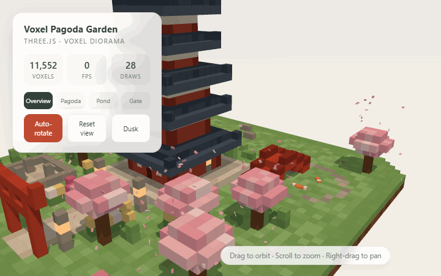
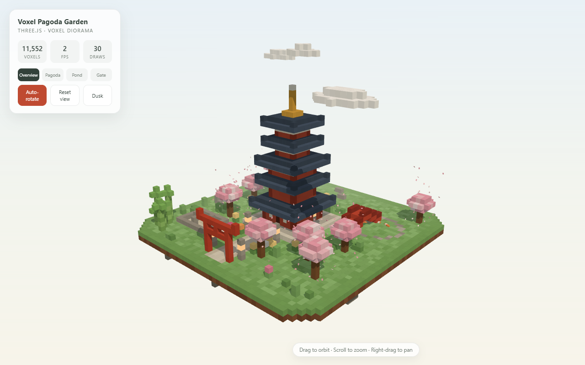
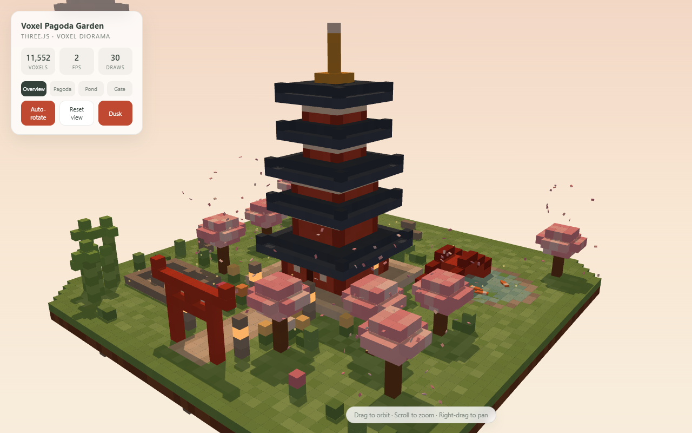
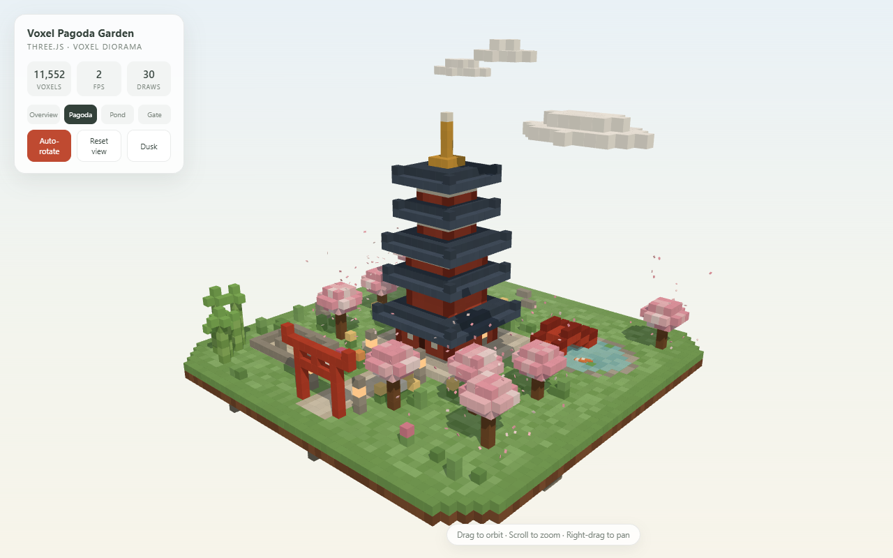
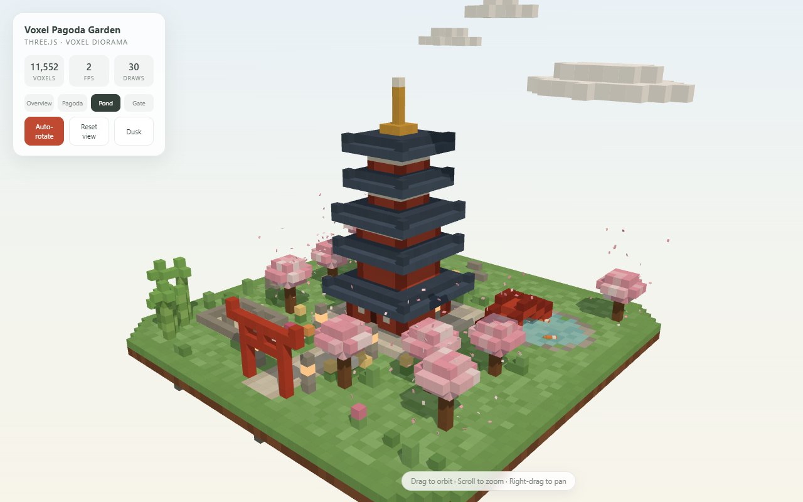
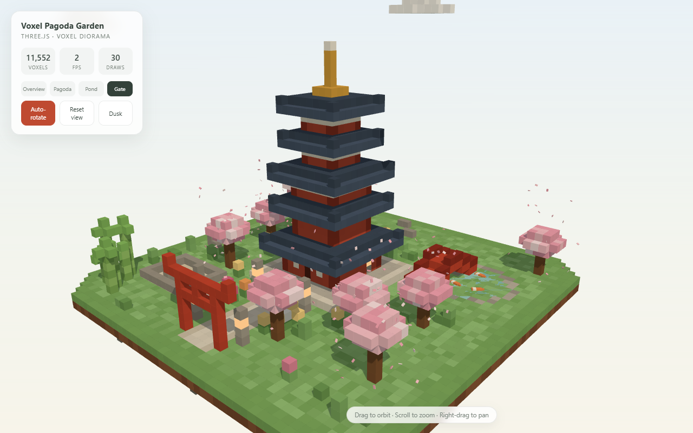
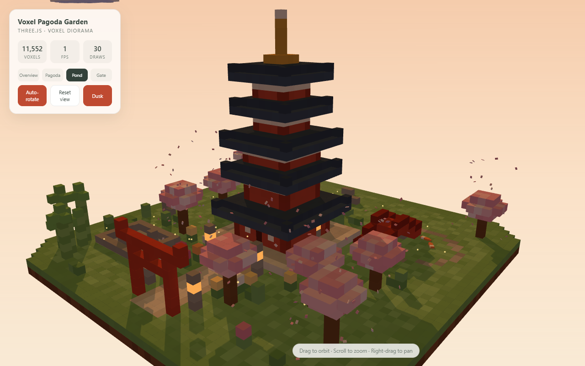
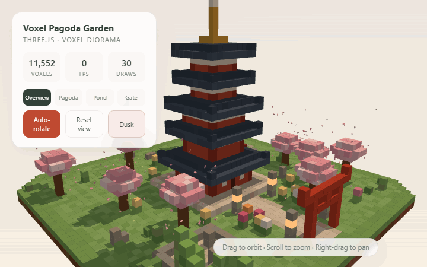

# 🏯 Voxel Pagoda Garden

*A serene Japanese garden diorama — five-tier pagoda, koi pond, blossom rain and
lantern-lit dusk — built voxel by voxel and rendered with Three.js.*



[**▶ Live demo on GitHub Pages**](https://jasontm17.github.io/Voxel-Pagoda-Garden/) ·
[Gallery](#-gallery) · [Quick start](#-quick-start) · [Tech notes](#-tech-notes) ·
[License](#-license)


---

## ✨ Features

- 🏯 **Five-tier pagoda** with stepped roofs, upturned corner tips, pale trim
  rings and a gold finial — dead centre of the island on a stone courtyard
- ⛩️ **Torii gate** opening onto a long stone approach path lined with flowers
- 🐟 **Living koi pond** — translucent bobbing water, lily pads and three koi
  swimming laps under an arched red bridge with stone piers
- 🌸 **Blossom rain** — 220 instanced petals tumbling from nine cherry trees
- 🪨 **Zen rock garden** (karesansui) with raked gravel rings, plus a bamboo grove
- 🏮 **Dusk mode** — one click lerps sky, fog, sun and hemisphere light to a warm
  evening; lantern windows glow, point lights fade in and fireflies drift out
- 🎥 **Cinematic camera** — intro fly-in on load and four eased presets
  (Overview / Pagoda / Pond / Gate)
- ☁️ Drifting voxel clouds casting slow moving shadows
- 🏝️ One cohesive floating landmass with earthen cliff layers and a rugged underside
- 🖥️ **Minimal light-theme dashboard** — live voxel count, FPS, draw calls,
  view presets, auto-rotate and dusk toggles

## 🖼️ Gallery

| Midday | Dusk |
|:---:|:---:|
|  |  |
| *The whole island: pagoda centred, torii south, pond east, zen garden north-west* | *Same island at dusk — lanterns lit, sky warm* |

| Pagoda preset | Pond preset | Gate preset |
|:---:|:---:|:---:|
|  |  |  |
| *The five tiers and gold finial* | *Koi circling under the arched bridge* | *Looking through the torii down the approach* |


*The pond at dusk — glowing lantern windows and koi at the surface*

### 🎬 Motion

| | |
|:---:|:---:|
|  |  |
| *Auto-orbit around the island* | *Day → dusk theme cross-fade* |

> Screenshots/GIFs were captured headless with software WebGL, so the FPS chip
> in them reads low — on any real GPU the scene runs at a smooth 60 fps.

## 🚀 Quick start

```bash
git clone https://github.com/JasonTM17/Voxel-Pagoda-Garden.git
cd Voxel-Pagoda-Garden
npm install
npm run dev        # → http://localhost:5173
```

Production build:

```bash
npm run build      # → dist/
npm run preview    # serve the production build locally
```

## 🎮 Controls

| Input | Action |
| --- | --- |
| Left-drag | Orbit around the island |
| Scroll | Zoom |
| Right-drag | Pan |
| `Overview / Pagoda / Pond / Gate` | Smooth eased camera presets |
| `Auto-rotate` | Toggle the slow orbit |
| `Reset view` | Snap back to the home shot |
| `Dusk` | Cross-fade day ↔ lantern-lit evening |

A tiny console playground is exposed for tinkerers:

```js
garden.flyTo(new THREE.Vector3(20, 12, 20), new THREE.Vector3(0, 8, 0));
garden.setDusk(true);
garden.controls.autoRotateSpeed = 3;
```

## 🗺️ The grounds

```
        🎋 bamboo (south-west corner)
  🪨 zen garden (north-west)
                 ┌───────────────┐
                 │ 🌸   🏯    🌸  │  five-tier pagoda on a stone
                 │ 🏮  plaza  🏮 │  courtyard, centred at (0,0)
                 │ 🌸   │     🌸 │
                 │      │       │ 🐟 koi pond + red bridge (east)
                 │ 🌸   │    🌸 │
                 │      ⛩️      │  torii gate, long approach path
                 └───────────────┘
   one floating landmass, ±24 voxels, three earthen cliff layers
```

Everything is placed by a **seeded** generator (`mulberry32`), so the garden
is identical on every load: 11,552 voxels of terrain, architecture and flora,
plus 220 petals, 42 fireflies, 3 koi and 3 clouds as animated actors.

## 🧱 Tech notes

- **One voxel map → one `InstancedMesh`** with per-instance colors and a subtle
  hash-based tonal jitter; water, lantern glow, petals, fireflies and clouds
  get their own small instanced batches. The whole frame is ~30 draw calls
  including the shadow pass.
- **Animation** runs through a single `updates(t, dt)` array: water bob, koi
  orbits steered along their heading, petal fall/sway/tumble, cloud drift,
  firefly wander — zero allocations per frame.
- **Day/dusk** is a damped scalar mix that lerps sky gradient stops (a 2×512
  canvas repainted while transitioning), fog color/range, sun & hemisphere
  colors, intensities and sun position, lantern point-light intensity and the
  glow tint every frame.
- **Koi without flicker** — they ride the surface so backs stay above and
  bellies below the bobbing water plane; no coplanar z-fighting.
- **Camera tween** eases position + orbit target with cubic in-out; any
  pointer-down cancels it for instant manual control.
- **Shadows**: a single 2048² PCF-soft directional map over a ±40 frustum;
  clouds cast slow moving shadows across the garden.
- Zero runtime dependencies beyond `three`; Vite is the only dev tooling.

## 📁 Project structure

```
├── index.html               # page shell + light-theme dashboard UI
├── vite.config.js           # base './' so the build also runs on GitHub Pages
├── scripts/
│   └── capture-media.mjs    # puppeteer + gifenc docs media generator
├── src/
│   ├── main.js              # renderer, lights, camera, theme system, dashboard
│   └── world.js             # seeded voxel world builder + animated actors
└── docs/                    # screenshots, GIFs and the GitHub Pages build
```

## 📸 Regenerating the docs media

```bash
npm run dev                        # terminal 1
npm i --no-save puppeteer gifenc pngjs
npm run capture                    # terminal 2 → writes docs/*.png / *.gif
```

## 🌐 GitHub Pages

`docs/` also holds a relative-base production build (`npm run build:pages`),
served as the live demo from the `docs/` folder of `main`:
**https://jasontm17.github.io/Voxel-Pagoda-Garden/**

## 📄 License

MIT © 2026 JasonTM17 (Nguyen Son) — see [LICENSE](LICENSE).
The garden is generated at runtime; no external art assets are used.

---

*Made with 🍵 and Three.js — enjoy the garden.*
